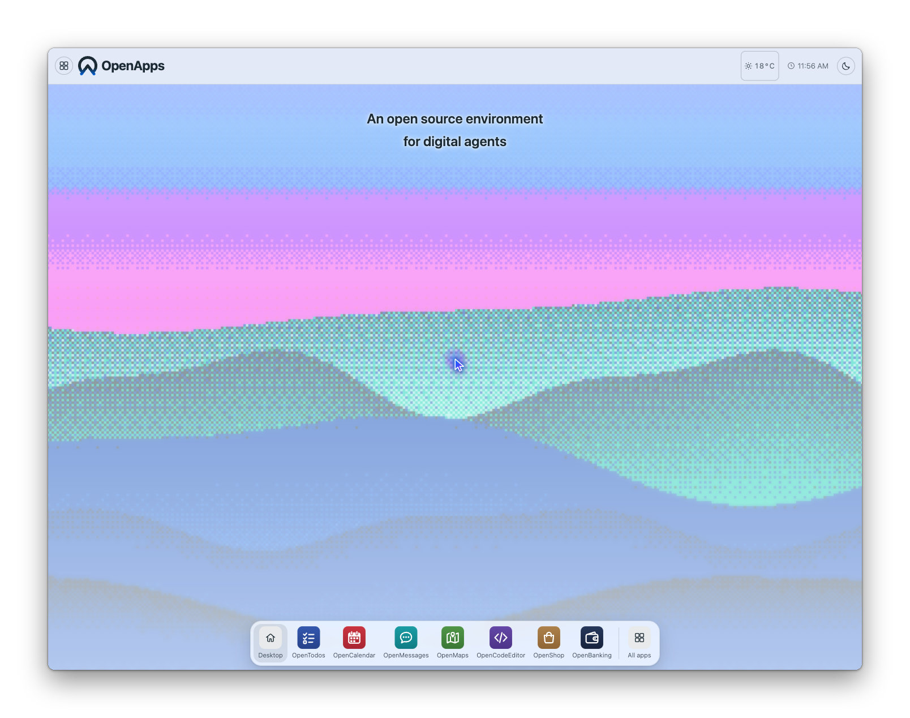

<div align="center">

 #   OpenApps

*Building Blocks for Computer-Use Agents Research*

🏆 ICLR Oral, Top 1%

[📒 docs](https://facebookresearch.github.io/OpenApps/)  | [📑 ArXiV](https://arxiv.org/abs/2511.20766) | [🎬 Video Tutorial](https://www.youtube.com/watch?v=gzNW_LXE7OE)
</div>


Evaluate and train multimodal agents to use apps like humans do (by clicking, typing, and scrolling):

✅ **Unlimited data** (for evaluating and training UI-agents): Configurable state and design to generate thousands of versions of each app

✅ **Lightweight**: runs on a single CPU (and Python-based); no Docker or OS emulators needed

✅ **Ground truth rewards**: task rewards are based on the underlying state and all app logic is transparent in Python


## Install

1. Clone
```
git clone https://github.com/facebookresearch/OpenApps.git
```

2. Install
```
uv sync
```

see [docs](https://facebookresearch.github.io/OpenApps/) for details.


## Run OpenApps

Simply run:

```bash
uv run launch.py
```



A browser opens on the apps once they are up, sized to the configured device.
Pass `headless=True` to just serve them.

Each app can be modified with variables available in `config/apps`. You can override any of these via command line:

```bash
uv run launch.py app.todo.title='Super Todo'
```

### Overrides: when to use `=`, `+=` and `+`

Hydra syntax, and the one thing worth memorising up front:

| Form | Means | Example |
| --- | --- | --- |
| `key=value` | Change something that already exists | `uv run launch.py device=phone` |
| `+key=value` | Add something not in the defaults list | `uv run launch.py +experiment=phone` |
| `++key=value` | Add *or* change, whichever applies | `uv run launch.py ++apps.todo.title=Tasks` |

A plain `=` fails on a key that does not exist yet, and a `+` fails on one that
does — the error tells you which you needed. Groups already in the defaults
list (`device`, `agent`, `tasks`, `apps/theme`, each app's `layout` and
`content`) take `=`. Only `experiment` needs `+`, because it is deliberately
not a default: an experiment config overrides *other* groups, so Hydra has to
compose it last, and appending it is what `+` does.

```bash
uv run launch.py device=phone                    # existing group
uv run launch.py apps/theme=dark                 # existing group
uv run launch.py +experiment=phone               # preset bundle, not a default
uv run launch.py +experiment=phone device=tablet # bundle, then override one part
```

An **experiment** is a named bundle that sets several groups at once, for the
cases where the halves have to agree. `+experiment=phone` is `device=phone`
plus the home-screen layout plus a larger step budget; `device=phone` alone
gives you a phone-sized window still rendering the desktop layout. See
`config/experiment/`.

Learn more about to customize the content and appearance of apps in the [docs](https://facebookresearch.github.io/OpenApps/). 

For a hot reloading dev server (live changes in browser):
`scripts/dev.sh`

## The online shop

The shop is a Python rewrite of [WebShop](https://github.com/princeton-nlp/WebShop),
on by default with a 999-product catalog from WebShop's item dump. See
[Online Shop](docs/onlineshop.md) for its variations, catalog and data.

## Launch an Agent

For agents to directly interact with apps, install: `playwright install chromium`.

Launch an agent to perform a task of *adding a meeting with Dennis to the calendar*:


```
# export GPT55_API_KEY=""
uv run launch_agent.py agent=GPT-5.5-computer-use task_name=add_meeting_with_dennis
```

To see the agent solving the task live, add the headless argument:
```
uv run launch_agent.py ... browsergym_env_args.headless=False
```


You can specify the agent of your choice with the `agent=` argument. For example `agent=dummy` is a simple agent that clicks randomly on any buttons, great for exploration!

Learn more about launching with OpenAI, Claude, and VLLM models such as UI-Tars in our [docs](https://facebookresearch.github.io/OpenApps/).

### Sweep tasks and agents

`launch_parallel_agents.py` is the one entry point for running many episodes,
on this machine or on SLURM. A sweep is task files × agents × app variations ×
tasks × repeats, and every run gets its own web app, port window, logs and
databases.

```bash
# every task in two files, with two agents, across the configured app variations
uv run launch_parallel_agents.py tasks=original_tasks.yaml,longer_horizon.yaml \
    agents=dummy,GPT-5.5-computer-use

# four runs at a time on this machine, each task three times, grouped in W&B
uv run launch_parallel_agents.py agents=GPT-5.5-computer-use \
    max_parallel=4 parallel_tasks.repeats=3 use_wandb=True

# on SLURM, one job per run, against the node serving a self-hosted model
uv run launch_parallel_agents.py mode=slurm_cluster \
    agents=gemma-4-31B-computer-use agent.hostname=auto
```

| Option | Effect |
| --- | --- |
| `tasks=a.yaml,b.yaml` | Task files to sweep (`.yaml` optional). The same task name in two files is two runs. |
| `agents=a,b` | Agents to sweep. Not combinable with `agent=...` or `--multirun`. |
| `parallel_tasks.task_names=[x,y]` | A subset of tasks across the files; `all` for every task. An explicit single `tasks=...` file runs in full with `agents=...` unless this selects a subset. |
| `parallel_tasks.app_variations=[[],["apps/theme=dark"]]` | App variations; each inner list is one variation's overrides (`[]` is the default apps). |
| `parallel_tasks.repeats=N` | Every run N times with the seed fixed, to measure run-to-run variance. |
| `max_parallel=N` | Local only: N runs at once, each in its own process, logging to `<job_id>/run.log`, with a summary at the end. The default, 1, runs them one at a time and streams to the terminal. |
| `mode=slurm_cluster` | Submit through submitit, one CPU job per run, with `slurm_sweep_launcher` from `config/mode/slurm_cluster.yaml`. |
| `agent.hostname=auto` | Find the SLURM node serving a self-hosted (vLLM) agent's model, from your running jobs. |
| `use_wandb=True` | The sweep's runs share a W&B group named after its `run-<id>` directory, with the agent as `job_type`. |

**Stopping a local sweep.** Ctrl-C stops it: queued runs never start, and
running ones stop their web apps and exit (Ctrl-C again kills them at once).
The launcher exits with status 130. Any failed run makes it exit non-zero too.

SLURM setup (account, QOS, a shared `logs_dir`, the vLLM serve job) is in the
[agents docs](docs/agents.md). Existing `agent=...`, `tasks=...` and Hydra
`--multirun` commands keep their behavior.

`logs_dir` is a parent directory. Every launcher invocation creates a fresh
`run-<id>/` underneath it and prints `Run directory: <path>`. Job configs, logs
and databases live under `<logs_dir>/run-<id>/<job_id>/`; SLURM output lives in
`<logs_dir>/run-<id>/slurm/`. Reusing the same logs root, including with native
Hydra `--multirun`, therefore keeps job storage separate across runs.
The run directory uses mode `0755`, so teammates can read and traverse it.
**Compatibility:** analysis expecting `<logs_dir>/<job_id>/` must include the
new run-directory level. Saved configs identify `task_config_name` and
`agent_config_name` for matrix runs.

Downstream packages can import `launch_parallel` and `normalize_cli_args` from
`open_apps.parallel_launcher`, keep their own Hydra entry point, and pass an
importable `launcher_class` to `launch_parallel`.
Custom app-subprocess launchers should forward `++web_app_port=<selected port>`
to the server so large sweeps reuse the exact port chosen by their parent.
Python callers of helpers in the repository script should import them from
`open_apps.parallel_launcher` instead.

Stagger independent launches on the same host to avoid the existing app-port
race. Wait for the previous sweep's jobs to finish before starting another;
a SLURM submission command returning does not mean its servers have started
or stopped. A single comma-selector sweep already gives its jobs distinct
preferred port ranges. Separate run directories protect storage but do not
reserve ports. Hydra's own parent-level logs can still append in the logs root.

## Environment variables

Copy [`.env.example`](.env.example) and fill in what you need — `launch_agent.py` and
`launch_parallel_agents.py` call `load_dotenv()`, so a `.env` at the repo root is picked up
automatically, and `.env` is git-ignored so keys stay out of the configs:

```bash
cp .env.example .env
```

| Variable | Read by | Purpose |
| --- | --- | --- |
| `USER` | `config/config*.yaml`, `config/mode/*` | W&B `entity` and the `logs_dir` path |
| `GPT55_API_KEY` | `config/agent/GPT-5.5-*.yaml` | key for the OpenAI-compatible endpoint |
| `AWS_ACCESS_KEY_ID`, `AWS_SECRET_ACCESS_KEY`, `AWS_SESSION_TOKEN` | `config/agent/claude_4_sonnet.yaml` (`client_type: aws`) | Bedrock credentials, when left null in the config |
| `WANDB_API_KEY`, `WANDB_BASE_URL`, `WANDB_MODE` | `wandb` | auth, self-hosted server, and `WANDB_MODE=offline` to skip online logging |
| `EXPERIMENT_CONFIG_PATH` | `src/open_apps/configs.py` | optional path loaded by `load_config()` instead of the default config |

Agent API keys are read through Hydra interpolation, so any variable name works — point the
agent's `api_key` at the one you use:

```bash
uv run launch_agent.py agent=GPT-5.5-computer-use 'agent.api_key=${oc.env:OPENAI_API_KEY}'
```

The batch scripts take environment variables too (`AGENTS`, `COUNT`, `MAX_PARALLEL`,
`VLLM_HOST`, …), but they are read by the shell, **not** through `.env` — export them at the
call site, or `set -a; source .env; set +a` first. They are listed in the
[agents docs](https://facebookresearch.github.io/OpenApps/agents/); the MCP server's
variables are in [`src/open_apps/mcp/README.md`](src/open_apps/mcp/README.md).

## Running on a cluster

`config/mode/slurm_cluster.yaml` and the `#SBATCH` lines in `scripts/conduct_slurm.sh` ship
with placeholder accounts and paths that `sbatch` will reject. Copy the mode to an
`internal-` twin — `.gitignore` keeps any `internal-*` file untracked, so your site's paths
and account names can't be committed by accident:

```bash
cp config/mode/slurm_cluster.yaml config/mode/internal-slurm_cluster.yaml
uv run launch_parallel_agents.py mode=internal-slurm_cluster agent=dummy \
    tasks=longer_horizon parallel_tasks.task_names=all use_wandb=True
```

See the [agents docs](https://facebookresearch.github.io/OpenApps/agents/) for the full
SLURM + vLLM + W&B walkthrough.

## OpenApps in action


https://github.com/user-attachments/assets/40482d53-9481-4e48-962b-eb384e94e3c7


## Reproducing the paper

`main` moves. The [`v1.0-paper`](https://github.com/facebookresearch/OpenApps/releases/tag/v1.0-paper) tag pins the paper-era config surface used for the variation grid in [arXiv:2511.20766](https://arxiv.org/abs/2511.20766) — check it out if you are reproducing or comparing against our setup:
```bash
git clone https://github.com/facebookresearch/OpenApps.git
cd OpenApps
git checkout v1.0-paper
uv sync
```

Everything after that tag is free to diverge. The first such change is the appearance refactor: the per-app `appearance` config group is replaced by a shared `apps/theme` (look) plus a per-app `apps/<app>/layout` (structure), so overrides written as `apps/todo/appearance=dark_theme` no longer resolve on `main`. See [App variations](https://facebookresearch.github.io/OpenApps/#app-variations) in the docs for the current axes, which include a table mapping every old `appearance` value onto its replacement.

The tag is the config surface the paper used, not a byte-exact snapshot of the runs: it carries the app, task and harness fixes landed since publication, some of which move rewards (map tasks now match coordinates by ground distance, for example). Expect small differences from the published tables.

## Contributing

We welcome pull requests with new features or issues via GitHub.


### Development

```
uv sync --extra dev
```

To build docs:

```
mkdocs build
mkdocs serve
```

this will launch docs available at https://facebookresearch.github.io/OpenApps/


### Testing

Run all tests via:

```python
uv run -m pytest tests/
```


## Attribution

Our apps are built on top of several excellent frameworks:

- FastHTML [framework](https://github.com/AnswerDotAI/fasthtml) and [examples](https://github.com/AnswerDotAI/fasthtml-example) which allowed us to build fully functional apps in Python, the language most familiar to AI researchers.
- [Browser Gym](https://github.com/ServiceNow/BrowserGym/blob/main/LICENSE) and [AgentLab](https://github.com/ServiceNow/AgentLab/blob/main/LICENSE):
- Open Street Maps: https://www.openstreetmap.org/copyright for our Maps apps.
- (for the online shop) [WebShop](https://github.com/princeton-nlp/WebShop/blob/master/LICENSE.md), developed by Princeton University: our shop is a rewrite, and its catalog is converted from WebShop's item dump.

Some icons are have been designed using resources from Flaticon.com

Our work is licensed under CC-BY-NC, please refer to the [LICENSE](LICENSE) file in the top level directory.

Copyright © Meta Platforms, Inc. See the [Terms of Use](https://opensource.fb.com/legal/terms/) and [Privacy Policy](https://opensource.fb.com/legal/privacy/) for this project.

## Acknowledgements

* A big thank you to Taj Gillin for implementing an MCP interface for OpenApps and Jiayu Wang for suggestions to improve our harness!
* Another thank you to Yuval Kansal for fixing inconsistencies in task phrasings!

## Featured In

* BrowserGym: https://github.com/servicenow/browsergym
* NE Agents Day (🏆Oral Award) : https://ne-agents-day.github.io/
* OpenEnv (HugginFace and PyTorch RL environment):  https://huggingface.co/docs/openenv/environments/openapp

## Cite

```
@article{ullrich2025openapps0,
  title   = {OpenApps: Simulating Environment Variations to Measure UI-Agent Reliability},
  author  = {Karen Ullrich and Jingtong Su and Claudia Shi and Arjun Subramonian and Amir Bar and Ivan Evtimov and Nikolaos Tsilivis and Randall Balestriero and Julia Kempe and Mark Ibrahim},
  year    = {2025},
  journal = {arXiv preprint arXiv: 2511.20766}
}
```
